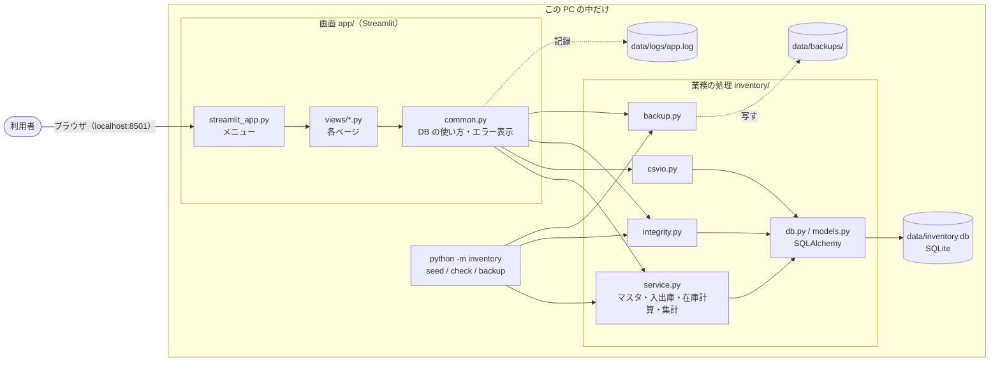
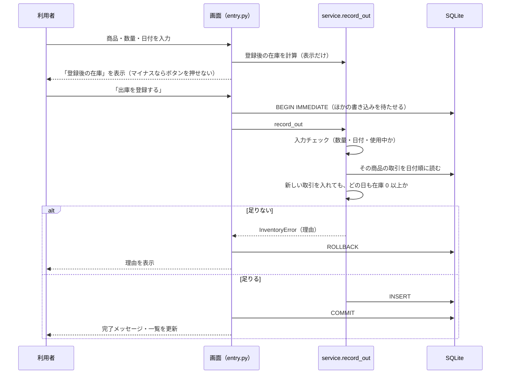

# 02 基本設計書

## 1. 技術構成図



- 画面は業務のルールを持たない。登録・検索・集計はすべて `service.py` などの関数を呼ぶ
- 画面とコマンドは同じ関数を使うので、どちらから使っても同じルールで動く

## 2. 処理の流れ（出庫の登録）



## 3. 画面設計

左にメニュー、右にページ。各ページは「タイトル → 一文の説明 → 絞り込み・入力 → 数字のカード → 表・グラフ → 操作」の順に並べる。

```
┌───────────────┬──────────────────────────────────────────┐
│ ■ 在庫管理システム │ ダッシュボード                                         │
│ ホーム          │ 在庫の今の様子です。…                                  │
│  ▦ ダッシュボード │ ┌商品数┐┌在庫金額┐┌在庫切れ┐┌要発注┐┌今月の入庫/出庫┐  │
│ 毎日の作業      │ │ 12  ││¥218,800││ 2件  ││ 3件 ││  572 / 536   │  │
│  ⇅ 入庫・出庫の登録│ └───┘└────┘└───┘└──┘└───────┘  │
│  ▤ 在庫一覧     │ ⚠ 要対応の商品（🔴在庫切れ／🟡要発注 の表）→ 入庫を登録する    │
│ 記録を見る      │ ▮ 月別の入庫・出庫（棒）   ◔ カテゴリ別の在庫金額（横棒）  │
│  ↺ 取引履歴・取消 │ ↺ 最近の取引（表）→ 取引履歴をすべて見る                 │
│  ▮ 月別集計     │                                                    │
│ マスタ          │                                                    │
│  ◇ 商品 / カテゴリ│                                                    │
│ データ管理      │                                                    │
│  CSV / 整合性 / バックアップ │                                         │
│ ⚠ 要対応 5 件     │                                                    │
└───────────────┴──────────────────────────────────────────┘
```

| ページ | 主な部品 |
| --- | --- |
| ダッシュボード | 数字のカード 5 つ、要対応の商品、月別の入出庫（棒）、カテゴリ別在庫金額（横棒）、最近の取引。空の DB なら「見本データを入れる」「自分のデータで始める」 |
| 入庫・出庫の登録 | 入庫／出庫／棚卸調整の切り替え、使い分けの説明、入力欄（左）、登録前後の在庫と状態（右）。マイナスになるときはボタンを押せない |
| 在庫一覧 | カテゴリ・状態・キーワード・基準日で絞り込み、合計のカード、在庫数のバー付きの表、CSV |
| 取引履歴・取消 | 期間・カテゴリ・商品・種類・キーワード・取消を隠す、件数と合計、表、CSV、取消（取引を選ぶ → 理由 → 確認のチェック → 取り消す） |
| 月別集計 | 開始の年月・カテゴリ・商品、合計のカード、棒グラフ（値つき）、表、CSV |
| 商品 | 一覧／追加する／変更・使用停止 のタブ |
| カテゴリ | 一覧（商品数・在庫数）、追加、名前の変更・使用停止 |
| CSV 取り込み・書き出し | 取り込む：種類 → 形の説明とひな形 → ファイル → 確認 → 取り込む（誤りは行番号つきの表）。書き出す：商品・在庫・取引 |
| 整合性チェック | チェックする → 8 項目の結果（問題のある項目は開いて表示） |
| バックアップ | 今すぐバックアップ、一覧とダウンロード、戻し方 |

- 状態は色の丸（🔴🟡🟢⚪）と文字の両方で表す（色だけに頼らない）
- 完了したときは緑のメッセージと右下の通知、エラーは赤のメッセージで理由を出す
- 明るさは右上の「︙」から Light／Dark／System

## 4. データ設計

[03 DB 設計書](03_DB設計書.md) を参照。

## 5. エラーの扱い

| 種類 | 例 | 画面 | ログ |
| --- | --- | --- | --- |
| 業務ルール・入力の誤り（InventoryError） | 在庫不足、未来の日付、重複コード | 理由をそのまま赤で表示。何も保存しない | なし |
| 想定外のエラー | DB が使えない、プログラムの不具合 | 「想定外のエラー（受付番号）」だけ。何も保存しない | 受付番号とトレースバック |

Streamlit の設定 `showErrorDetails = "none"` で、万一表示側に届いた例外も詳細を出さない。
