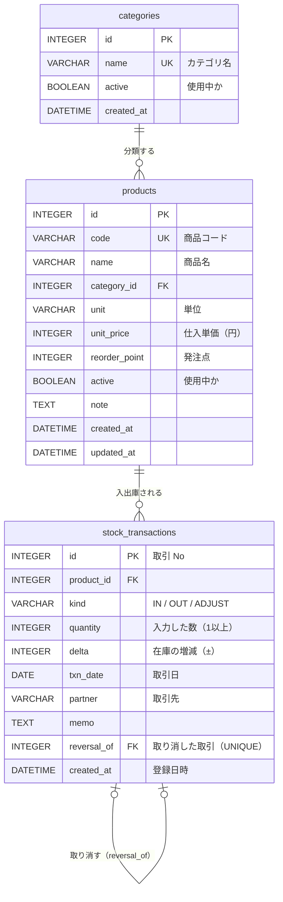

# 03 DB 設計書

DB：SQLite（`data/inventory.db`）。接続ごとに `PRAGMA foreign_keys=ON`、ファイルは WAL モード。定義は `inventory/models.py`。

## 1. ER 図



## 2. テーブル

### categories（カテゴリ）

| 列 | 型 | NULL | 制約・既定 | 内容 |
| --- | --- | --- | --- | --- |
| id | INTEGER | × | PK | |
| name | VARCHAR(50) | × | UNIQUE、`length(trim(name)) > 0` | カテゴリ名（大文字小文字違いも重複とみなす：処理側で確認） |
| active | BOOLEAN | × | 既定 true | 使用中か |
| created_at | DATETIME | × | 既定 現在時刻 | |

### products（商品）

| 列 | 型 | NULL | 制約・既定 | 内容 |
| --- | --- | --- | --- | --- |
| id | INTEGER | × | PK | |
| code | VARCHAR(20) | × | UNIQUE | 商品コード（大文字の英数字・`-`・`_`） |
| name | VARCHAR(100) | × | code と name は空不可（CHECK） | 商品名 |
| category_id | INTEGER | × | FK → categories.id（ON DELETE RESTRICT） | |
| unit | VARCHAR(10) | × | 既定「個」 | 単位 |
| unit_price | INTEGER | × | `>= 0` | 仕入単価（円）。在庫金額・月別金額に使う |
| reorder_point | INTEGER | × | `>= 0` | 発注点。在庫がこの数以下で「要発注」 |
| active | BOOLEAN | × | 既定 true | 使用中か |
| note | TEXT | × | 既定 '' | メモ |
| created_at / updated_at | DATETIME | × | 既定 現在時刻（更新時に updated_at を更新） | |

### stock_transactions（入出庫の取引）

| 列 | 型 | NULL | 制約・既定 | 内容 |
| --- | --- | --- | --- | --- |
| id | INTEGER | × | PK | 取引 No |
| product_id | INTEGER | × | FK → products.id（RESTRICT） | |
| kind | VARCHAR(10) | × | `IN`・`OUT`・`ADJUST` のどれか（CHECK） | 入庫・出庫・棚卸調整 |
| quantity | INTEGER | × | `> 0` | 入力した数 |
| delta | INTEGER | × | `<> 0` | 在庫の増減 |
| txn_date | DATE | × | | 取引日 |
| partner | VARCHAR(100) | × | 既定 '' | 仕入先・出荷先 |
| memo | TEXT | × | 既定 '' | |
| reversal_of | INTEGER | ○ | FK → stock_transactions.id、**UNIQUE** | 取消の取引のとき、取り消した元の取引 |
| created_at | DATETIME | × | 既定 現在時刻 | 登録日時 |

向きの CHECK（`ck_txn_direction`）：取消でない取引は `IN` なら `delta = quantity`、`OUT` なら `delta = -quantity`、`ADJUST` なら `abs(delta) = quantity`。

インデックス：`(product_id, txn_date, id)`（商品ごとの日付順の計算用）、`(txn_date)`（期間の検索・月別集計用）。

## 3. 設計の考え方

| 決めたこと | 理由 |
| --- | --- |
| 在庫数の列を持たない（`SUM(delta)` で求める） | 二重管理によるずれをなくす。任意の日の在庫も `txn_date <= 日付` で出せる |
| `quantity`（入力値）と `delta`（増減）を分けて持つ | 集計が `SUM` だけで済む。入力どおりの数も残る |
| 取消は行を追加し、`reversal_of` を UNIQUE にする | 履歴を消さない。二重の取消を DB でも防ぐ |
| 削除は RESTRICT、マスタは「使用停止」 | 取引の残っている商品・カテゴリが消えて、履歴が読めなくなるのを防ぐ |
| 金額は円の整数 | 小数の誤差を出さない |
| 日付は DATE、登録日時は DATETIME を別に持つ | 「いつの取引か」と「いつ入力したか」を区別する（監査用） |

## 4. よく使う問い合わせ

```sql
-- 商品ごとの在庫数（基準日つき）
SELECT product_id, SUM(delta) AS stock
FROM stock_transactions
WHERE txn_date <= :as_of
GROUP BY product_id;

-- 月別集計（取消は元の月で差し引かれる）
SELECT strftime('%Y-%m', txn_date) AS month,
       SUM(CASE WHEN kind = 'IN'  THEN delta ELSE 0 END)  AS in_qty,
       SUM(CASE WHEN kind = 'OUT' THEN -delta ELSE 0 END) AS out_qty
FROM stock_transactions GROUP BY month ORDER BY month;
```

## 5. バックアップ

SQLite の backup 機能でファイルを写す（使用中でも壊れない）。`data/backups/inventory_日時.db`、新しいものから 30 個を残す。
